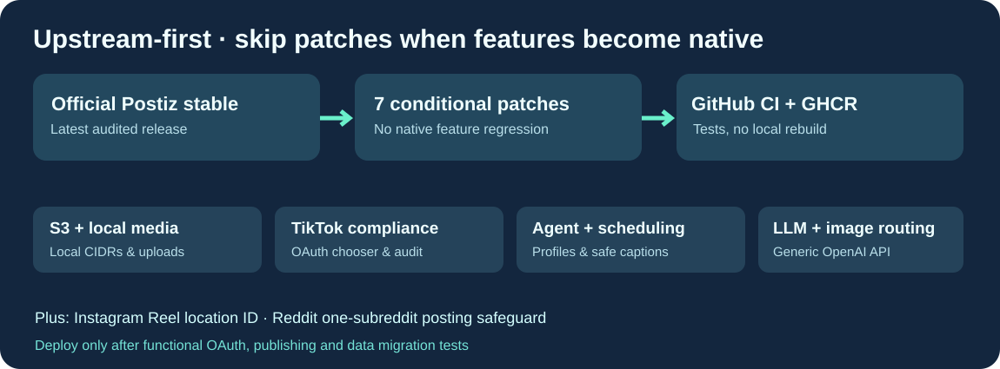

# Cloud9-Postiz

**Postiz officiel dans sa dernière release stable, augmenté de huit adaptations conditionnelles, compilées dans GitHub et distribuées via GHCR.**

[English](README.md) · Français · [简体中文](README.zh-CN.md)

L'objectif est de **ne pas maintenir un fork complet divergent** : GitHub récupère la dernière release officielle Postiz, applique seulement les fonctions qui manquent encore, puis publie une image candidate précompilée. Cloud9 n'a donc plus besoin de compiler pendant ses mises à jour.

## Huit améliorations utiles à tous

- S3 et upload local sécurisé par plages CIDR configurables.
- Agent pour médias locaux, transcription, upload, programmation intelligente, contrôle Unicode et profil éditorial externe.
- Options de confidentialité et d'audit pour la publication directe TikTok.
- Choix de compte TikTok lors des connexions OAuth multiples.
- Garde-fou Reddit : un seul subreddit par publication.
- Identifiant de lieu pour Reel Instagram.
- Routage du texte et des images IA vers un serveur compatible OpenAI.
- Lecture locale sécurisée des médias YouTube hébergés dans /uploads sans désactiver la protection SSRF.

Les deux anciens correctifs pour couvertures Instagram/TikTok ne sont plus appliqués, car la version officielle les possède déjà.

## Sécurité et distribution

Aucune donnée personnelle, aucun token, aucun identifiant de compte ni URL privée dans le dépôt public ou l'image. Les clés, profils éditoriaux et mentions légales spécifiques à l'exploitant doivent rester dans des volumes ou fichiers privés. Les pages légales TikTok incluses sont des exemples : avant utilisation réelle, l'exploitant doit vérifier sa marque, son domaine et ses autorisations TikTok.

La CI vérifie l'application propre des patchs, les fonctions de couverture upstream et l'image Docker. **La publication latest et la migration de production sont interdites jusqu'aux tests fonctionnels OAuth/publication/S3 sur l'instance de référence.**

Code officiel Postiz AGPL-3.0 ; adaptations Cloud9 AGPL-3.0. Projet non affilié à Postiz.
