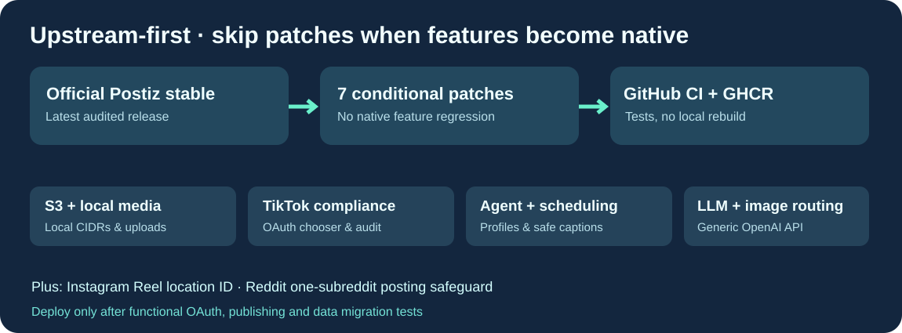

# Cloud9-Postiz

**[Postiz](https://github.com/gitroomhq/postiz-app) upstream stable with seven carefully isolated, conditional enhancements. GitHub builds the Docker candidate; production never needs a source compile.**

English · [Français](README.fr.md) · [简体中文](README.zh-CN.md)

## Why this distribution exists

Cloud9 does not maintain an independent, lagging copy of the Postiz application. GitHub Actions fetches the **current official stable release**, applies only enhancements still missing in upstream, checks the expected native Instagram and TikTok cover functions, and packages a validated candidate image. Whenever a feature lands upstream, its patch is automatically skipped after compatibility checks.

### What Cloud9 adds

| Patch family | Function |
|---|---|
| postiz-s3 | S3 media ingress plus private-LAN local uploads, with configurable CIDR allowlist |
| postiz-local-agent | Local media agent, transcription, upload, scheduling analytics, configurable external editorial profile, Unicode validation |
| postiz-tiktok-audit | TikTok creator metadata, Direct Post privacy/interaction/disclosure options, publishing review pages |
| postiz-tiktok-multiaccount | Always show TikTok OAuth account chooser for multiple accounts |
| postiz-reddit-responsible-builder | Limit each Reddit submission to one subreddit |
| postiz-instagram-location | Instagram Reel location_id |
| postiz-omniroute | Configurable OpenAI-compatible text/image endpoint for Postiz generation and agents |

Two cover patches from the former local repository were **removed**: current upstream already supports Instagram Reel cover_url and TikTok video_cover_timestamp_ms.

## Operator separation

The public patches are free of personal names, accounts, tokens and private network addresses. The self-hosted operator supplies all OAuth keys, S3 keys, specific creator voice profiles, and their own approved legal/privacy texts **outside the image**.

**Important:** The generic TikTok review, privacy and terms pages are templates, not legal advice or a substitute for app-specific approval. A production TikTok application must be reviewed for its actual operator and domain, and operators must confirm that their own legal branding and approvals remain valid. The source-only repository intentionally does not include any user's private legal identity.

## Verification and release policy

- GitHub Actions fetches the current Postiz stable tag, detects when patched functions are already native, then applies the remaining mail patches in a fixed order.
- The build fails closed if media covers regress, Postiz APIs change incompatibly, or a patch cannot be applied cleanly.
- Publish an **immutable candidate** only after image build/static compatibility checks. Do not auto-push latest or update production before authenticated posting E2E (Instagram, TikTok, Reddit), S3/local upload, agent generation and existing database integrity are validated.
- README translations, SVG diagrams and source privacy gates are tested before pushing candidates.
- Legacy, private operator-specific style profiles stay in local volumes, not in GitHub or GHCR.

**Upstream:** Gitroom/Postiz, AGPL-3.0. Patches are distributed under AGPL-3.0. Not affiliated with the official Postiz project. The linked upstream source remains the canonical base.
