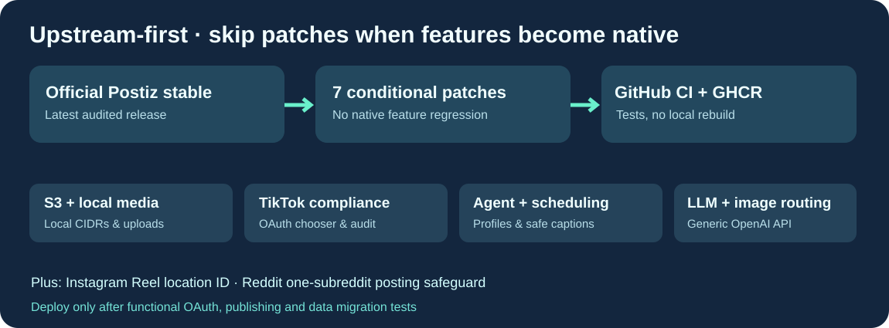

# Cloud9-Postiz

**官方 Postiz 稳定版 + 八组可自动跳过的功能增强，使用 GitHub Actions 构建 GHCR 镜像。**

[English](README.md) · [Français](README.fr.md) · 简体中文

本项目不会长期维护与上游分离的整套 Postiz 源码。GitHub 获取最新官方稳定版本，检查哪些增强功能已被上游实现，仅应用仍有必要的补丁，并进行 Docker 构建与功能兼容性检查。生产服务器升级时无需本地编译。

八组改进：S3 与本地媒体上传；本地媒体智能代理、转录和定时分析；TikTok Direct Post 的权限及隐私流程；TikTok 多账号 OAuth 选择器；Reddit 单 subreddit 安全限制；Instagram Reels 地点标识；OpenAI 兼容文本及图像生成服务路由；同源 YouTube 媒体安全本地读取（保留外部 SSRF 防护）。

Instagram 和 TikTok 的封面功能现在已由官方 Postiz 支持，因此原来的两份封面补丁已经废弃。

**隐私与部署要求**：仓库、构建镜像不包含用户密钥、账号、个人品牌资料或私有 IP。实际 OAuth 账号、S3 密钥、编辑风格配置和 TikTok 法律声明应由部署者在私有配置中提供。附带的通用法律页面仅供参考，不能代替真实应用的审核及授权。

CI 检验官方源版本、条件补丁应用及镜像中的功能路径。未经真实 OAuth、发布、数据库和媒体上传端到端检查，不自动更新生产服务或发布 latest 标签。

官方 Postiz 与 Cloud9 补丁遵守 AGPL-3.0。本项目非 Postiz 官方产品。
